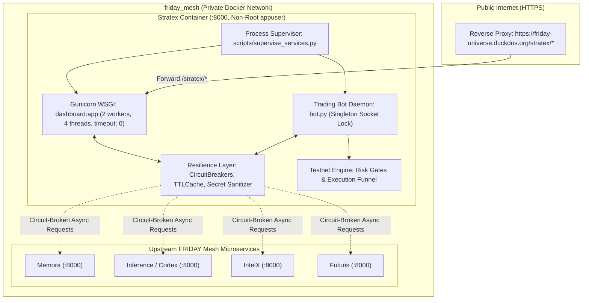

# STRATEX — Quantitative Algorithmic Execution & Live Telemetry Platform

[](https://www.python.org/)
[](https://gunicorn.org/)
[](https://flask.palletsprojects.com/)
[](https://www.docker.com/)
[](https://friday-universe.duckdns.org)
[](LICENSE)

---

## 🏛️ Executive Summary & Architecture

**Stratex** is the dedicated 24/7 algorithmic trading, quantitative execution, and live telemetry platform of the **FRIDAY Universe**. It operates autonomously in continuous execution mode to discover trade opportunities, evaluate multi-timeframe quantitative strategies, manage microstructural friction, enforce portfolio risk limits, and execute orders against Binance Testnet while providing real-time telemetry streaming to the ecosystem.



---

## 🌐 Infrastructure & Network Topology

Stratex is modernized and deployed on **Oracle Cloud Always Free**:

| Component | Specification |
| :--- | :--- |
| **Hardware Target** | Oracle Cloud Always Free (2 OCPUs, 12 GB RAM Ampere A1 ARM64 / AMD x86_64 host) |
| **Public Gateway URL** | `https://friday-universe.duckdns.org/stratex/` |
| **Internal Mesh URL** | `http://stratex:8000` (Directly reachable by FRIDAY Core) |
| **Internal Container Port** | `8000` (*Port 5000 is permanently decommissioned*) |
| **Host Mapped Port** | `8008` (`8008:8000`) |
| **Container Mesh Network** | `friday_mesh` (Docker bridge network managed with Caddy HTTPS proxy) |
| **Execution WSGI Stack** | Multi-threaded Gunicorn (`--bind 0.0.0.0:8000 --workers 2 --threads 4 --timeout 0 dashboard:app`) |
| **Bot Execution Daemon** | Singleton process `bot.py` managed via `scripts/supervise_services.py` |

---

## 🛡️ Safeguards & Execution Isolation

Stratex implements strict defense-in-depth safeguards preventing unintended real-money order execution:

1. **Testnet / Paper Isolation**:
   - `LIVE_TRADING_ENABLED` is hardcoded to `False` by default in source.
   - `ExecutionPolicy.can_place_order()` strictly checks `TRADING_MODE`, `TESTNET_ENABLED`, and `LIVE_TRADING_ENABLED`. Orders are blocked with explicit rejection reasons (`LIVE_TRADING_LOCKED`, `TESTNET_DISABLED`).
2. **Singleton Socket Lock**:
   - `bot.py` acquires an exclusive local socket lock (`acquire_singleton_lock(port=48888)`) with `SO_REUSEADDR` and `atexit` cleanup. This guarantees that container restarts or duplicate supervisor triggers cannot run parallel order-dispatching loops.
3. **Atomic File Persistence**:
   - Trade ledgers (`testnet_trade_ledger.jsonl`), portfolio snapshots (`testnet_portfolio.json`), and equity records (`testnet_equity_history.jsonl`) are managed via atomic write-and-rename mechanics to prevent file corruption during abrupt shutdowns.
4. **Signal Trapping & Clean Teardown**:
   - `scripts/supervise_services.py` traps `SIGTERM`, `SIGINT`, and `SIGHUP`. It forwards termination signals to both child processes, awaiting exit for up to 5 seconds before forcing termination.

---

## 📡 API & Telemetry Specifications

Stratex provides structured JSON and Server-Sent Event (SSE) endpoints:

### Core Endpoints

#### `GET /health` or `GET /api/health`
Returns process liveness status suitable for container orchestrators and reverse proxy healthchecks.
```json
{
  "status": "ok",
  "dashboard": "online",
  "mode": "TESTNET",
  "evidence_class": "process_liveness",
  "engine": "online",
  "engine_healthy": true,
  "engine_trading_capable": false,
  "capability_reasons": ["NO_VALIDATED_STRATEGIES_LOADED"],
  "observed_at": "2026-10-14T21:30:00Z"
}
```

#### `GET /ready` or `GET /api/ready`
Returns `HTTP 200 OK` only when the trading engine has a fresh heartbeat and is capable of generating signals, or `HTTP 503 Service Unavailable` otherwise.

#### `GET /api/status`
Authoritative system status, portfolio balances, risk utilization, and performance metrics.
```json
{
  "status": "ok",
  "dashboard": "online",
  "evidence_class": "process_liveness",
  "mode": "TESTNET",
  "overall_health": "OK",
  "equity": 10000.0,
  "cash": 10000.0,
  "crypto_holdings_value": 0.0,
  "total_pnl": 0.0,
  "realized_pnl": 0.0,
  "unrealized_pnl": 0.0,
  "win_rate": 0.0,
  "open_positions": 0,
  "max_drawdown": 0.0,
  "observed_at": "2026-10-14T21:30:00Z"
}
```

#### `GET /api/stream`
Server-Sent Events (SSE) telemetry stream for real-time frontend charts and bot state propagation.
* *Note: Requires `--timeout 0` in Gunicorn WSGI configuration to prevent connection drops.*

#### `GET /api/positions`
Returns current open positions, active stop-loss (SL) / take-profit (TP) prices, unrealized PnL, and duration.

#### `GET /api/trades`
Returns the historical executed trades ledger, win/loss breakdown, gross profit/loss, and total net returns.

#### `GET /api/circuit-breakers`
Real-time diagnostic telemetry on all internal mesh circuit breakers (`intelx`, `futuris`, `inference_prediction`):
```json
{
  "status": "OK",
  "service": "stratex",
  "circuit_breakers": {
    "intelx": {
      "name": "intelx",
      "state": "CLOSED",
      "failure_count": 0,
      "failure_threshold": 4,
      "recovery_timeout": 30.0,
      "total_trips": 0,
      "seconds_since_state_change": 12.4
    }
  },
  "timestamp": "2026-10-14T21:30:00Z"
}
```

#### Standardized API Error Envelopes
All API routes (`/api/*`) return clean, predictable, and sanitized JSON error payloads:
```json
{
  "error": "BAD_REQUEST",
  "message": "Invalid query parameters provided",
  "success": false
}
```

#### Risk Control Halters (`POST /api/panic`, `POST /api/halt`, `POST /api/unhalt`)
Emergency risk control endpoints to immediately halt scanning, disallow new entries, or flatten existing exposures. Protected by `require_bot_api_key` and scoped authentication tokens.

---

## ⚙️ Environment Configuration

Stratex reads environment variables from `.env`. A complete configuration template is provided in `.env.example`.

The credential sets for legacy Binance Testnet and the current Demo Trading environment are not interchangeable. When `BINANCE_DEMO_TRADING=true`, the Binance venue agent requires the fresh `BINANCE_API_KEY` and `BINANCE_API_SECRET` values and pins execution to Demo endpoints. It does not fall back to legacy keys. Use `GET /api/agents` to inspect the safe agent catalog and configuration state.


| Variable | Description | Default | Allowed Values |
| :--- | :--- | :--- | :--- |
| `PORT` | WSGI listening port | `8000` | Any valid TCP port |
| `TRADING_MODE` | Execution mode | `PAPER` | `PAPER`, `TESTNET`, `FUTURES` |
| `TESTNET_ENABLED` | Allow the existing non-production execution path | `False` in the sample | `True`, `False` |
| `LIVE_TRADING_ENABLED` | Live money trading | `False` | Must remain `False` |
| `BINANCE_DEMO_TRADING` | Select current Binance Demo Trading endpoints | `false` | `true`, `false` |
| `BINANCE_API_KEY` | Current Binance Demo Trading API key (when Demo Trading is selected) | Empty | Demo Trading key only |
| `BINANCE_API_SECRET` | Current Binance Demo Trading API secret | Empty | Demo Trading secret only |
| `API_KEY` / `SECRET_KEY` | Legacy Binance Testnet credentials (used only when Demo Trading is false) | Placeholder in sample | Legacy Testnet keys only |
| `MT5_BRIDGE_ENABLED` | Enable the remote MT5 bridge adapter | `false` | `true`, `false` |
| `MT5_BRIDGE_URL` | Private/VPN address for the Windows MT5 bridge | Empty | Private network URL only |
| `MT5_BRIDGE_TOKEN` | Bearer token for the MT5 bridge | Empty | High-entropy secret |
| `MAX_TESTNET_EXPOSURE` | Maximum portfolio capital exposure | `0.05` | Float (e.g. `0.05` = 5%) |
| `MAX_DAILY_LOSS_PCT` | Maximum daily loss tolerance | `0.02` | Float (e.g. `0.02` = 2%) |
| `MAX_TESTNET_DRAWDOWN_PCT` | Maximum drawdown circuit breaker | `0.05` | Float (e.g. `0.05` = 5%) |
| `MAX_OPEN_POSITIONS` | Maximum simultaneous open positions | `5` | Positive integer |
| `INFERENCE_URL` | FRIDAY Cortex / Inference gateway | `https://friday-universe.duckdns.org/cortex` | Mesh route |
| `MEMORA_URL` | FRIDAY Memora cloud memory gateway | `https://friday-universe.duckdns.org/memora` | Mesh route |
| `INTELX_URL` | FRIDAY IntelX research gateway | `https://friday-universe.duckdns.org/intelx` | Mesh route |
| `FUTURIS_URL` | FRIDAY Futuris predictive forecasting | `https://friday-universe.duckdns.org/futuris` | Mesh route |
| `STRATEX_URL` | Public Stratex gateway route | `https://friday-universe.duckdns.org/stratex` | Gateway URL |

---

## 🚀 Deployment & Operations

### Docker Compose (Production Deployment)

Run Stratex directly attached to the `friday_mesh` Docker bridge:

```bash
# 1. Create or ensure friday_mesh exists
docker network create friday_mesh || true

# 2. Build and launch container
docker compose up -d --build

# 3. Check container logs
docker compose logs -f stratex
```

### Local Development / Supervisor

To execute locally under Python 3.11+:

```bash
# 1. Create and activate virtual environment
python -m venv .venv
source .venv/bin/activate  # On Windows: .venv\Scripts\activate

# 2. Install dependencies
pip install -r requirements.txt

# 3. Launch supervised services
python scripts/supervise_services.py
```

### Testing & Verification

Run the full automated test suite:

```bash
pytest -v --tb=short
```
